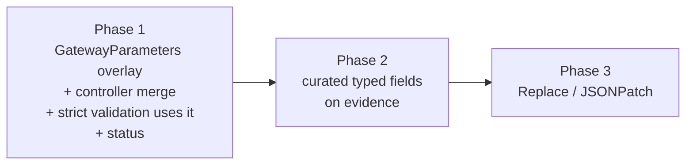
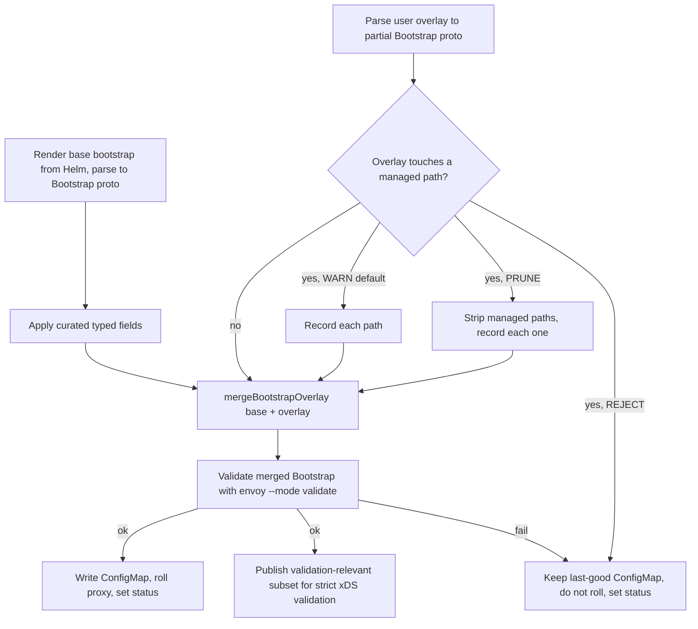

# EP-13666: Mutable Envoy bootstrap config for managed gateway proxies

- Issue: [#13666](https://github.com/kgateway-dev/kgateway/issues/13666)
- Merge function origin: [#14752](https://github.com/kgateway-dev/kgateway/pull/14752)
- Strict validation dependency: [#14814](https://github.com/kgateway-dev/kgateway/issues/14814)

> **Requirement change (revision 2).** Some bootstrap settings decide whether
> translated xDS is accepted, e.g. `re2.max_program_size.error_level`. Strict
> validation must therefore validate routes against the bootstrap the target proxy
> actually runs, so **the controller must know the effective bootstrap**. That makes
> the controller-side merge the only supported mechanism:
>
> - **Phase 0 (envoyinit `OVERLAY_CONF`, #14752) is dropped.** It merges in the pod,
>   out of the controller's sight, and adds nothing once Phase 1 ships. Its merge
>   function and tests move into Phase 1.
> - **A managed path set by the user is applied and reported,** not pruned or
>   rejected, so overrides stay possible through the API.
>
> Sections changed: Background, Goals, Non-Goals, Phasing, Phase 0 (removed),
> Worked example, Merge semantics, Pipeline, Guardrails, Validate the merged result,
> Deployer, Reporting, Write-time feedback, Phase 2, Translator and Proxy Syncer,
> Test Plan, Alternatives, Open Questions. Some revision 1 statements were stale
> against `main` (`851bfc9c3cf3`) and are updated: the base bootstrap no longer has a
> `static_layer`, `maxDownstreamConnections` is an exposed knob, and
> `k8s.io/apiserver` is now v0.37.1.

## Background

For a managed gateway proxy, kgateway's deployer generates the Envoy bootstrap
(`envoy.yaml`) from an internal Helm template, stores it in a `ConfigMap` named
after the `Gateway`, and mounts it into the proxy `Pod` at `/etc/envoy` via a
volume named `envoy-config`. The `envoy-wrapper` (envoyinit) reads that file and
feeds it to Envoy as the whole bootstrap.

`GatewayParameters.spec.kube.envoyContainer.bootstrap` exposes only a handful of
curated knobs today (`logLevel`, `componentLogLevels`, `logFormat`,
`dnsResolver.udpMaxQueries`, `enableReadinessProbeProxyProtocol`,
`maxDownstreamConnections`). Anything else
in the bootstrap — **Envoy reloadable feature flags**
(`envoy.reloadable_features.*`), `stats_config.histogram_bucket_settings`
([#14088](https://github.com/kgateway-dev/kgateway/issues/14088)),
`stats_flush_interval`, extra runtime layers, alternate DNS resolver settings, custom
static clusters — is not reachable through the API.

The concrete motivating case (this issue, #13666) is reloadable feature flags. When
an Envoy upgrade changes behavior, Envoy ships a `envoy.reloadable_features.<name>`
flag so operators can roll the behavior back temporarily while they adapt; the flag
is later removed once the new behavior is settled. Those flags live in the bootstrap
(as a `layered_runtime` layer), so today a kgateway user has no supported way to set
one. The issue explicitly asks that this be solved **generically — a way to alter
the bootstrap, not a reloadable-feature-specific knob** — which is the shape this EP
takes.

A second case shows why the merge must happen in the controller. Envoy rejects a
regex whose compiled program size exceeds the runtime key
`re2.max_program_size.error_level` (default 100); long literal paths, such as regexes
generated from OpenAPI path templates, exceed it easily. A user can raise the limit
in the proxy's runtime, but under `validation.level: strict` the controller validates
each route against its own synthetic bootstrap, which has no `layered_runtime`
([`pkg/xds/bootstrap/builder.go`](https://github.com/kgateway-dev/kgateway/blob/851bfc9c3cf37139586e82c1c0081ff718c02799/pkg/xds/bootstrap/builder.go#L256)).
The route is dropped before it reaches a proxy that would accept it (#14814).

The current answer is a workaround: copy the generated bootstrap into a custom
`ConfigMap`, add the desired config, and repoint the `envoy-config` volume at it
using a `deploymentOverlay` (`spec.kube.deploymentOverlay`). This works, but it
forces the user to own a **complete, verbatim copy** of the generated bootstrap,
including control-plane–managed fields (`node.cluster`, `node.metadata.role`, the
`xds_cluster`, the xDS JWT credential config, `dynamic_resources`).

### Relevant sources

- Bootstrap template: `pkg/kgateway/helm/envoy/templates/configmap.yaml`
- Wrapper that loads, transforms, and re-marshals the bootstrap proto:
  `pkg/envoyinit/run.go`
- Merge function: `mergeBootstrapOverlay` in `pkg/envoyinit/overlay.go` (#14752),
  to move into a package the deployer can use
- API types: `api/v1alpha1/kgateway/gateway_parameters_types.go` (`EnvoyBootstrap`)
- Controller settings: `api/settings/settings.go`
- Overlay precedent (strategic merge patch with `$patch` directives):
  `api/v1alpha1/shared/overlay_types.go` (`KubernetesResourceOverlay`)

## Motivation

The workaround is fragile in exactly the way an API should not be. The moment
kgateway changes its bootstrap template in a future version — a new xDS field, a
new static listener, a renamed cluster, a new managed filter — the user's copied
`ConfigMap` silently drifts from the generated format. There is no merge, no
validation, and no warning; the user must manually re-reconcile their copy on every
upgrade, and a stale copy can break xDS connectivity or crash-loop the proxy.

We want a way to mutate the bootstrap that:

1. lets the user express **only their delta**, not a full copy,
2. **continues to apply correctly when the base bootstrap meaningfully changes**
   in a future version, because untouched fields flow through automatically, and
3. is **known to the controller**, so xDS validation sees the same bootstrap the
   proxy runs.

## Goals

- **Phase 1:** provide a `GatewayParameters` API to mutate the managed proxy's Envoy
  bootstrap without copying the whole document, applied as a **structured patch
  against the Envoy `Bootstrap` proto after the base bootstrap is generated**, so the
  base can evolve across versions without breaking user config.
- **The controller knows the effective bootstrap of every Gateway it manages.**
  Strict route validation uses its validation-relevant subset, so a setting that
  changes what Envoy accepts behaves the same under `standard` and `strict` (#14814).
  Bootstrap inputs the controller does not manage (`-c`, a replacement `ConfigMap`,
  self-managed Gateways) are out of scope; validation for them uses Envoy defaults,
  as today.
- **The user's value wins, and kgateway reports when it disagrees.** A patch that
  sets a control-plane–managed field is applied and flagged on status, in events and
  in metrics. Operators who want enforcement can opt into pruning or rejecting.
- Validate the merged bootstrap before rollout and report results on the `Gateway`'s
  status, rather than crash-looping Envoy.
- Satisfy [#14088](https://github.com/kgateway-dev/kgateway/issues/14088)
  (`stats_config.histogram_bucket_settings`): expressible through the overlay in
  Phase 1, and promoted to a curated, validated field in Phase 2.

## Non-Goals

- Replacing the existing `deploymentOverlay` mechanism. It remains the escape hatch
  for `Deployment`-level changes (volumes, sidecars, etc.); this EP is specifically
  about bootstrap *content*.
- Mutating dynamic (xDS-delivered) config such as listeners, routes, and clusters.
  Those are owned by the translation pipeline and configured via Gateway API and
  policy CRDs.
- Validating `-c` (see Alternatives). It merges in the proxy pod at startup, so the
  controller cannot see it; it remains a documented escape hatch for settings
  kgateway does not set.
- Arbitrary text/templating of the bootstrap document (see Alternatives).
- An admission webhook (see Write-time feedback).

## Implementation Details

### Design principle

Apply mutations as a **proto-level patch onto the freshly generated `Bootstrap`** —
never as a textual or whole-document replacement. This is the same layering Envoy
itself uses (`--config-path` + `--config-yaml`, which is a proto `MergeFrom`).
Because the patch targets stable proto field paths rather than line/character
positions, it keeps working when the surrounding base config changes.

### Phasing



- **Phase 1 — API, controller-side merge, validation, status (the supported MVP).**
  Moves the merge function from #14752 into the controller and adds managed-field
  reporting, merged-result validation, strict xDS validation against the merged
  bootstrap, status reporting, and automatic rollout.
- **Phase 2 — promote curated fields on evidence.** Start generic, curate when a
  given overlay shape recurs.
- **Phase 3 — removal/replace strategies.** Only once a concrete need for
  non-additive edits appears.

There is no Phase 0. Revision 1 proposed an envoyinit overlay (`OVERLAY_CONF`,
#14752) as a bridge; it is listed under Alternatives. Until Phase 1 ships, `-c`
covers settings kgateway does not set, and full bootstrap replacement remains the
documented break-glass option.

Layer 2 of the Phase 1 API (the overlay) is strictly more general than Layer 1
(curated fields): anything a curated field does, the overlay can already express. So
we ship the overlay first and curate later.

### Phase 1: API, controller merge, guardrails

#### Configuration

Extend `EnvoyBootstrap` in `api/v1alpha1/kgateway/gateway_parameters_types.go` with
a `patches` field, structured in two layers. Phase 1 ships Layer 2 only; Layer 1
fields arrive in Phase 2.

```yaml
apiVersion: gateway.kgateway.dev/v1alpha1
kind: GatewayParameters
metadata:
  name: my-gateway
spec:
  kube:
    envoyContainer:
      bootstrap:
        patches:
          # Layer 1 (Phase 2): curated, strongly-typed fields for common cases.
          statsConfig:
            histogramBucketSettings:
              - match: { prefix: "cluster." }
                buckets: [1, 5, 10, 25, 50, 100, 250, 500, 1000, 2500, 5000, 10000]

          # Layer 2 (Phase 1): typed proto-merge escape hatch for everything else.
          overlay:
            mergeStrategy: StructuredMerge   # default, and the only value in Phase 1
            value:                           # a partial envoy.config.bootstrap.v3.Bootstrap
              stats_flush_interval: 10s
              layered_runtime:
                layers:
                  - name: user_runtime
                    static_layer:
                      envoy.reloadable_features.no_extension_lookup_by_name: false
```

1. **Curated typed fields** (`statsConfig.histogramBucketSettings`,
   `statsFlushInterval`, `dnsResolver`, ...). These give CRD validation,
   documentation, and a stable contract. Issue #14088 is the first candidate for
   promotion (Phase 2); until then it goes through the overlay.
2. **A typed proto overlay** (`overlay.value`), stored with
   `+kubebuilder:pruning:PreserveUnknownFields` and parsed by the controller as a
   *partial* `envoy.config.bootstrap.v3.Bootstrap`. The API server does not validate
   under `PreserveUnknownFields`, so typos and bad types are caught by the controller
   and reported on status. Because it is keyed by proto field, it survives
   base-template changes.

#### Worked example: reloadable feature flags

There is **no flat "reloadable features" field** in the Envoy bootstrap — a feature
flag like `envoy.reloadable_features.<name>` is just a runtime key, set through
`layered_runtime.layers[].static_layer` as shown above.

- The generated base bootstrap **already defines** a `layered_runtime` with a single
  layer, `admin_layer`
  ([`configmap.yaml`](https://github.com/kgateway-dev/kgateway/blob/851bfc9c3cf37139586e82c1c0081ff718c02799/pkg/kgateway/helm/envoy/templates/configmap.yaml#L47-L50)).
- Envoy resolves each runtime key from the last layer that sets it, and the
  `admin_layer` must stay last so `/runtime_modify` keeps overriding everything.
  User layers are therefore inserted immediately before the first `admin_layer`.
  A user layer overrides any earlier layer but not `/runtime_modify`.
- Give the user layer a **distinct `name`** (e.g. `user_runtime`). Envoy rejects
  duplicate layer names (`Duplicate layer name: <name>`,
  `source/common/runtime/runtime_impl.cc`), and `mergeBootstrapOverlay` rejects them
  earlier with a clearer message. `layered_runtime` is not a managed path.
- Envoy ignores runtime keys it does not know, so a flag that a later Envoy removes
  never fails validation; it silently stops having an effect. The release notes of
  the Envoy bump, not this mechanism, are the signal for that.

#### Merge semantics

Proto `MergeFrom` is additive: repeated fields append, singular fields overwrite,
messages merge recursively. It cannot *remove* or wholesale-*replace* a repeated
field. We model `mergeStrategy` on the *vocabulary* of the existing
`KubernetesResourceOverlay` (`api/v1alpha1/shared/overlay_types.go`), but this is a
**conceptual** borrow, not a code reuse: that overlay is implemented with Kubernetes
strategic merge patch (`pkg/deployer/strategicpatch/strategicpatch.go`), which
depends on `patchStrategy`/`patchMergeKey` struct tags the Envoy `Bootstrap` proto
does not carry.

- `StructuredMerge` (default; Phase 1) — `mergeBootstrapOverlay` from #14752: proto
  `MergeFrom`, except that `layered_runtime.layers` are inserted before the
  `admin_layer` rather than appended. The overlay wins conflicts and cannot reset a
  field to its zero value.
- `Replace` (Phase 3) — replace a named sub-message/list wholesale (e.g. fully define
  `stats_config`), using `$patch: replace` semantics.
- `JSONPatch` (Phase 3) — RFC 6902 ops against the bootstrap, for surgical removals.
  This is the one mode whose paths re-couple to base structure, so it is discouraged
  and documented as such.

A user static cluster whose name collides with a managed one cannot silently shadow
it: `StructuredMerge` appends a second cluster of the same name, and Envoy rejects
the bootstrap (`cluster manager: duplicate cluster 'xds_cluster'`,
`source/common/upstream/cluster_manager_impl.cc`). Validation catches that before
rollout, and the managed-path report below names `xds_cluster` as the cause.

#### Pipeline

Phase 1 merges in the controller, before the bootstrap `ConfigMap` is written, so the `ConfigMap` on the cluster is already the final
config and all logic and status reporting live in one place.



Today the deployer does not build a `Bootstrap` proto; it renders the bootstrap as
Helm text. Phase 1 adds a parse / mutate / re-marshal step, the same roundtrip
envoyinit already performs (`pkg/envoyinit/run.go`). The existing `pkg/xds/bootstrap`
`ConfigBuilder` is *not* a drop-in base generator: it synthesizes a bootstrap purely
to validate translated xDS.

#### Guardrails

##### Managed paths

The controller maintains a list of proto paths the control plane owns, all present
in the generated bootstrap (`pkg/kgateway/helm/envoy/templates/configmap.yaml`):

- `node`
- `dynamic_resources`
- `admin.address`
- `static_resources.clusters[name=xds_cluster]` (which also carries the xDS JWT
  credential injector)

Paths are matched on the **parsed proto** (field descriptors, with list entries
identified by key), never on raw YAML keys, because the proto JSON mapping accepts
both `dynamic_resources` and `dynamicResources`.

What happens to a patch that touches a managed path is an operator choice, set by a
new controller setting in `api/settings/settings.go`, modeled on `ValidationMode`:

```go
// BootstrapPatchManagedPaths determines what the controller does with a
// GatewayParameters bootstrap overlay that sets a control-plane-managed path.
// Supported values:
// - "WARN" (default): apply the overlay as written and report each managed path
//   it sets on status, in an event and in a metric.
// - "PRUNE": drop each managed path from the overlay before merging, apply the
//   rest, and report each dropped path.
// - "REJECT": apply none of the overlay and report the managed paths.
BootstrapPatchManagedPaths BootstrapPatchManagedPathsMode `split_words:"true" default:"WARN"`
```

That is `KGW_BOOTSTRAP_PATCH_MANAGED_PATHS=WARN|PRUNE|REJECT`.

**`WARN` is the default** because the user who sets a managed path usually means
it. The main reason to get under the hood is a security response, where overriding
something kgateway sets is the point; refusing it sends users back to full
bootstrap replacement, which has no validation or status at all. kgateway's job is
to make the override visible, not to forbid it. A managed path set by mistake
surfaces as a condition, an event and a metric. The condition reports that the
override applied, not that the proxy still works: an override can pass
`envoy --mode validate` and still cut the proxy off from the controller. For
example, `node.metadata.role` selects the proxy's xDS snapshot
([`xds/utils.go`](https://github.com/kgateway-dev/kgateway/blob/851bfc9c3cf37139586e82c1c0081ff718c02799/pkg/kgateway/xds/utils.go#L64-L79)).

On upgrade, `WARN` keeps an override applying as long as the merge still succeeds.
If kgateway N+1 starts managing a field a user set under N, the user's value still
applies and the conflict appears on status, instead of being silently dropped, so a
security-response override can survive a rollback. If N+1 adds a runtime layer or
static cluster with the same name as one the user defined, the merge or validation
fails and the Gateway follows the invalid-merge fallback, unrelated entries
included.

`PRUNE` and `REJECT` remain for platform teams that want enforcement:

- `PRUNE` drops the managed paths and applies the rest, so an unrelated, load-bearing
  entry (e.g. a reloadable feature flag) survives an upgrade that adds a managed
  path.
- `REJECT` applies nothing, for operators who would rather have patch authors fix
  mistakes. On an upgrade that adds a managed path, the whole overlay stops applying
  to affected Gateways, which then follow the invalid-merge fallback. The docs must
  say this plainly.

The operator (usually a platform team) owns this choice rather than the
`GatewayParameters` author, because under `PRUNE` or `REJECT` the author is the
person the setting constrains.

##### Growing the managed-path list

Under `WARN`, adding a path adds a report but does not change what applies. Under
`PRUNE` and `REJECT` it does, and new managed layers or clusters can collide by name
under any mode, so additions carry a release-note obligation. The per-path metric (see Reporting) lets a platform team
find affected Gateways *before* a version bump.

##### Validate the merged result

Run the combined `Bootstrap` through `envoy --mode validate` before rollout. A
reusable validator exists — `pkg/validator` (binary / docker / caching) — but today
it is wired only into the translator (`proxy_syncer.go` ->
`NewCombinedTranslator(..., validator)`), so reusing it on the bootstrap path is new
wiring. Prefer the binary validator where the Envoy binary is available; the docker
validator is fragile in network-restricted environments. `--mode validate` builds
both the runtime and the cluster manager, so it catches duplicate layer and cluster
names.

The validator cannot be reused unchanged. Its preparation step drops
`application_log_config`
([`validator.go`](https://github.com/kgateway-dev/kgateway/blob/851bfc9c3cf37139586e82c1c0081ff718c02799/pkg/validator/validator.go#L302-L308)),
which is right for xDS validation but would let an invalid log config in an overlay
through. Bootstrap validation needs its own mode that keeps it, and that defines how
proxy-only inputs are handled: the xDS token file, and the system CA secret
envoyinit adds at startup
([`run.go`](https://github.com/kgateway-dev/kgateway/blob/851bfc9c3cf37139586e82c1c0081ff718c02799/pkg/envoyinit/run.go#L44-L67)).

##### Invalid-merge fallback

When the overlay cannot be parsed, the merged bootstrap fails validation, or
`REJECT` refuses the overlay, the controller keeps the last-good bootstrap
`ConfigMap`, does not roll the proxy, and sets status. See Open Questions for the
upgrade and first-creation cases.

#### Deployer

- The bootstrap `ConfigMap` rendering gains the pipeline above.
- No new volumes or mounts; the existing `envoy-config` volume carries the merged
  bootstrap.
- Pods roll when the pod-template checksum changes. That checksum hashes the
  Helm-rendered `envoy.yaml`
  ([`deployment.yaml`](https://github.com/kgateway-dev/kgateway/blob/851bfc9c3cf37139586e82c1c0081ff718c02799/pkg/kgateway/helm/envoy/templates/deployment.yaml#L31-L34)),
  so a merge after rendering would not roll pods on an overlay-only change. The
  checksum must be computed from the final merged bootstrap.

#### Reporting

Status goes on the **`Gateway`**, not `GatewayParameters`:
`GatewayParametersStatus` is empty today, one `GatewayParameters` can serve many
Gateways, and the merged result is per Gateway.

Add a `BootstrapPatchApplied` condition:

| Status | Reason | When |
| --- | --- | --- |
| `True` | `Applied` | Whole overlay applied, no managed path set. |
| `True` | `ManagedPathsOverridden` | `WARN` applied an overlay that sets one or more managed paths. The message lists each path. |
| `True` | `PathsIgnored` | `PRUNE` dropped one or more managed paths; the rest applied. The message lists each dropped path. |
| `False` | `PathsDenied` | `REJECT` refused an overlay that touched managed paths. The message lists them. |
| `False` | `InvalidOverlay` | The overlay does not parse as a partial `Bootstrap`. |
| `False` | `ValidationFailed` | The merged bootstrap failed `envoy --mode validate`. |

`True` with `ManagedPathsOverridden` or `PathsIgnored` is deliberate: the patch did
apply, and a routine report must not read as a broken Gateway to anyone alerting on
condition status. `False` is reserved for cases where the overlay could not be
rolled out at all.

Also emit a `Warning` event for each overridden, dropped or denied path, and a
metric labeled by path (and Gateway). The managed-path list is small and enumerable,
so cardinality is bounded.

The honest cost of `WARN` as default: a mistaken override of a managed path takes
effect. The condition, the event and the metric make it visible; `PRUNE` and
`REJECT` exist for operators who want it prevented.

#### Write-time feedback

Enforcement stays in the controller, which is the only place that can validate
against the *current* base bootstrap (it changes on upgrade) and run
`envoy --mode validate`. kgateway has no admission webhooks today and this EP does
not add one.

CRD `x-kubernetes-validations` (CEL) rules could reject managed paths at write time,
but under the `WARN` default they would refuse what the controller applies, and a
CRD rule cannot depend on a controller setting. This EP therefore ships none. The
mechanics are recorded for `PRUNE`/`REJECT` users, should that change: CEL sees
only the properties a `PreserveUnknownFields` object declares: a rule naming an
undeclared field fails CRD creation (`compilation failed: undefined field 'node'`),
and undeclared fields are stored but invisible to rules. So each managed path must
be declared as a schema property alongside `PreserveUnknownFields`, in both
snake_case and lowerCamelCase. Keyed list entries work too, by declaring the list
with partially typed items (`type: object`, `PreserveUnknownFields`, and a
`name: string` property):

```yaml
x-kubernetes-validations:
- rule: "!has(self.node) && !has(self.dynamic_resources) && !has(self.dynamicResources)"
  message: node and dynamic_resources are managed by kgateway
- rule: >-
    !has(self.static_resources) || !has(self.static_resources.clusters) ||
    !self.static_resources.clusters.exists(c, has(c.name) && c.name == 'xds_cluster')
  message: static cluster xds_cluster is managed by kgateway
```

This was checked against envtest API servers v1.31.0 and v1.35.0. The controller
pinned `k8s.io/apiserver` v0.35.3 at the time, whose `pkg/cel/common/schemas.go`
documents the same behavior; `main` now pins v0.37.1, which these checks predate. Declaring properties does not prune anything: an allowed overlay
round-trips with its unknown fields intact.

### Phase 2: curated fields

When a given overlay shape recurs (starting with
`statsConfig.histogramBucketSettings` for #14088), promote it into a strongly-typed
Layer 1 field for CRD validation, documentation, and a stable contract. Promotion is
backward-compatible: the curated field and the overlay target the same proto path,
with the curated field applied first and the overlay layered on top. A curated
`staticResources.clusters` field, if demand warrants, can reject collisions with
managed cluster names up front with a clearer message.

The RE2 program size limit is the second candidate (`re2MaxProgramSize.errorLevel`
and `warnLevel`, rendered into kgateway's runtime layer). Through the overlay, a
misspelled runtime key is silently ignored by Envoy and the limit stays at 100; a
typed field is checked at write time and is discoverable in the API reference. It
needs no plumbing of its own: it renders into the merged bootstrap, which strict
validation already reads.

### Phase 3: removal and replace strategies

Add `Replace` and (discouraged) `JSONPatch` once a concrete need for non-additive
edits appears. `StructuredMerge` covers the additive majority. Managed paths are
handled the same way under these strategies.

### Translator and Proxy Syncer

Strict validation must see the bootstrap the target proxy runs. Today it builds its
own, with a node, a cluster manager and static resources but no `layered_runtime`
([`pkg/xds/bootstrap/builder.go`](https://github.com/kgateway-dev/kgateway/blob/851bfc9c3cf37139586e82c1c0081ff718c02799/pkg/xds/bootstrap/builder.go#L256)).

- **Insertion point.** Route validation already runs per Gateway, inside
  [`ComputeRouteConfiguration`](https://github.com/kgateway-dev/kgateway/blob/851bfc9c3cf37139586e82c1c0081ff718c02799/pkg/kgateway/translator/irtranslator/route.go#L66).
  The Gateway's validation-relevant bootstrap subset must reach **every** Envoy
  validation call there: the whole-configuration and shared-settings checks
  ([`route.go`](https://github.com/kgateway-dev/kgateway/blob/851bfc9c3cf37139586e82c1c0081ff718c02799/pkg/kgateway/translator/irtranslator/route.go#L540-L565)) as well
  as the per-route checks in
  [`routeValidationScope`](https://github.com/kgateway-dev/kgateway/blob/851bfc9c3cf37139586e82c1c0081ff718c02799/pkg/kgateway/translator/irtranslator/validate.go#L279).
  If any call is missed, a route can pass the scoped check and still fail the final
  whole-configuration check under Envoy defaults.
- **Source.** Nothing in `pkg/kgateway/translator` or `proxy_syncer` reads
  `GatewayParameters` today. The translator takes the subset from the same
  per-Gateway result the deployer produces in the Pipeline above, not from a second
  resolution of `GatewayParameters`. Which bootstrap that is while pods are still
  rolling is an open question (see Open Questions).
- **An allowlist, not the whole bootstrap.** The merged bootstrap carries
  `xds_cluster`, admin and file-based SDS references that do not resolve in the
  controller pod. Start with the static `layered_runtime` layers (not `admin_layer`
  or RTDS) and `default_regex_engine`. Add a field only with a test showing it
  changes what Envoy accepts.
- **Policy and backend validation keep Envoy defaults in Phase 1.** TrafficPolicy and
  BackendConfigPolicy are validated when the policy is constructed, before any
  Gateway is known
  ([`traffic_policy_plugin.go`](https://github.com/kgateway-dev/kgateway/blob/851bfc9c3cf37139586e82c1c0081ff718c02799/pkg/kgateway/extensions2/plugins/trafficpolicy/traffic_policy_plugin.go#L312-L327));
  backend and generated-listener validation have no Gateway either. With defaults,
  these paths can reject config a proxy with a raised limit would accept, e.g. a long
  CORS wildcard origin, which becomes a regex
  ([`cors.go`](https://github.com/kgateway-dev/kgateway/blob/851bfc9c3cf37139586e82c1c0081ff718c02799/pkg/pluginsdk/policy/cors.go#L148-L165)). If a user lowers a limit
  below Envoy's default, they can also accept config the proxy rejects. The docs must
  say both. Gateway-aware policy validation is a follow-up.
- **Caching and churn.** The validator caches by a hash of the bootstrap, so Gateways
  with different subsets stop sharing entries. Bootstrap fields are never copied into
  xDS, but a change to the subset revalidates that Gateway's routes and can change
  which routes are dropped or replaced, and so change RDS. Raising a limit restores
  dropped routes; lowering it drops them.

### Test Plan

- **Merge function (carried over from #14752):** unit tests for
  `mergeBootstrapOverlay` (layer placement, duplicate layer names,
  scalar/message/list semantics); docker tests that run Envoy with a merged
  bootstrap and assert, through the admin API, the running runtime layers,
  precedence, and `/runtime_modify` still winning.
- **Phase 1 unit:** managed-path matching on the parsed proto (snake_case and
  lowerCamelCase, keyed list entries); `WARN` applies everything and records each
  managed path; `PRUNE` strips exactly the managed paths and leaves the rest;
  `REJECT` applies nothing; the settings decoder accepts only
  `WARN`/`PRUNE`/`REJECT`; each status reason.
- **Phase 1 golden:** `GatewayParameters` inputs with overlays produce the expected
  merged bootstrap; a base-bootstrap change does not disturb the user delta
  (regression guard for "survives version change"); an overlay touching a managed
  path under each mode.
- **Phase 1 strict validation:** under `validation.level: strict`, a route whose
  regex exceeds the default RE2 limit is dropped without an overlay and programmed
  with one that raises `re2.max_program_size.error_level`, in both single- and
  multi-virtual-host configurations, so every validation call is covered. The same
  route on a second Gateway without the overlay is still dropped, and its status
  reports the drop only for that parent (the reporter is already per parent,
  `route.go#L178`). Lowering the limit drops the route again. `admin_layer` and
  non-allowlisted fields never reach the validation bootstrap.
- **Phase 1 bootstrap validation:** an overlay with an invalid
  `application_log_config` fails validation and is not rolled out.
- **Phase 1 rollout:** an overlay-only change changes the pod-template checksum;
  identical merged content does not; an invalid overlay keeps both the last-good
  `ConfigMap` and its checksum.
- **Phase 1 upgrade regression:** simulate a managed-path addition against a stored
  overlay that sets that path plus a runtime layer. Under `WARN` both still apply
  and status is `True`/`ManagedPathsOverridden`; under `PRUNE` the runtime layer
  still applies and status is `True`/`PathsIgnored`. Also simulate a new base
  runtime layer and static cluster whose names collide with the overlay's, under
  each mode, and assert the invalid-merge fallback.
- **Phase 1 e2e:** a new suite (there is no existing `/config_dump`
  `BootstrapConfigDump` assertion in the tree) that applies an overlay and asserts
  the running Envoy's bootstrap, plus a negative case for a managed path surfacing
  `ManagedPathsOverridden` (default), `PathsIgnored` (with `PRUNE`) and
  `PathsDenied` (with `REJECT`).

## Alternatives

- **Status quo: clone `ConfigMap` + `deploymentOverlay`.** Works today but requires a
  verbatim full copy of the generated bootstrap and silently drifts on upgrade.
- **envoyinit overlay (`OVERLAY_CONF`, #14752) as Phase 0.** Revision 1's bridge:
  envoyinit merges a user file over the generated bootstrap at proxy startup, and
  the user wins. It has no status, does not roll on edits, and is invisible to
  strict validation. Once Phase 1 ships with `WARN` it adds only a way around
  validation and status, so it is dropped; its merge function moves into Phase 1.
- **`--config-yaml` via `envoyContainer.extraArgs`.** The envoyinit wrapper already
  invokes Envoy with one `--config-yaml <generated bootstrap>`; a second one collides
  (`(--config-yaml) -- Argument already set!`).
- **`-c <overlay>` (`--config-path`) via `envoyContainer.extraArgs`.** Works today
  with no code change. Envoy loads `--config-path` first and merges the wrapper's
  `--config-yaml` over it, so **kgateway's bootstrap wins every conflict** and a stale
  user file can never override a managed field. The flip side: the user cannot
  override anything kgateway sets (e.g. the admin address, or the overload manager
  rendered from `maxDownstreamConnections`), and their runtime layers and other
  repeated-field entries come first. It covers adding a
  reloadable-feature flag kgateway does not set, but not overriding one it does.
  Verified in #14752 (`TestEnvoyExtraArgsConfigPathMergesUnderBootstrap`). It has no
  validation before rollout, no status, no rollout on edits, and is invisible to
  strict validation. It stays documented as an escape hatch for settings kgateway
  does not set.
- **`PRUNE` as the default.** Revision 1 of this EP. Safe across an unattended
  upgrade, but it makes overriding a managed path impossible through the API, which
  sends security responses back to full replacement. Kept as an opt-in mode.
- **Always reject a patch that touches a managed path.** The original draft of this
  EP. Clearest feedback for fresh mistakes, but an upgrade that grows the list takes
  out the user's unrelated, load-bearing entries unattended. Kept as the `REJECT`
  mode.
- **Per-`GatewayParameters` mode switch.** Puts the choice with the patch author, the
  person `PRUNE` and `REJECT` constrain. Rejected in favor of the controller
  setting.
- **Allowlist of top-level fields** (`stats_config`, `layered_runtime`,
  `stats_flush_interval`, `typed_dns_resolver_config`, `static_resources.clusters`).
  A typed, pruned schema would let CEL carry real enforcement weight, but it blunts
  the emergency/security-response use case that motivates the EP, and
  controller-side enforcement does not need it.
- **Admission webhook.** Immediate feedback, but a new moving part kgateway does not
  have today, and it still cannot validate against a future base bootstrap.
- **A single opaque "full bootstrap replacement" field.** Reintroduces the
  verbatim-copy problem and the managed-field hazard inside the CRD.
- **String templating of the bootstrap.** Text-level patches re-couple to
  line/character structure and break on base changes.
- **A dedicated RE2 setting with its own validator plumbing.** Fixes the RE2 case
  only; every other runtime key that changes what Envoy accepts would need the same
  plumbing again.
- **Per-regex `google_re2.max_program_size`** for the RE2 case. It travels in RDS,
  so the validator sees it without plumbing, but the field is deprecated, covers only
  regexes kgateway generates, disables the runtime warn level, and changing the limit
  rewrites every route with a regex.

## Open Questions

- **Invalid-merge fallback across an upgrade and on first creation.** "Keep last-good
  `ConfigMap`, do not roll" is well defined for an edit to an existing Gateway. After
  a kgateway upgrade, last-good was rendered by the previous version; keeping it means
  running an old bootstrap under the new control plane, and holding the `Deployment`
  too blocks that Gateway's upgrade. A new Gateway has no last-good at all. The
  alternative is failing open (roll the generated bootstrap without the overlay and
  set `False`), which proceeds but drops load-bearing settings. Which applies in each
  case?
- **Which bootstrap strict validation uses while pods roll.** Envoy reads its
  bootstrap only at startup, and kgateway builds one xDS snapshot per Gateway, so
  old and new pods receive the same config during a rollout
  ([`perclient.go`](https://github.com/kgateway-dev/kgateway/blob/851bfc9c3cf37139586e82c1c0081ff718c02799/pkg/kgateway/proxy_syncer/perclient.go#L210)).
  Both directions are unsafe if validation switches at the wrong moment:
  - **Widening** (e.g. raising a limit): if validation switches as soon as the
    `ConfigMap` changes, newly accepted routes reach old pods that still have the
    old limit. They reject the whole `RouteConfiguration` and stop applying route
    changes until replaced, indefinitely if the rollout stalls.
  - **Tightening** (e.g. lowering a limit, a stricter feature flag): if validation
    switches only after the rollout, new pods start with the stricter bootstrap
    while the served config still holds a route it rejects, and they have no
    earlier config to fall back to.

  Requirement: never push config that a running or starting proxy would reject.
  Options:
  - **Switch after rollout:** validate against the previous bootstrap until every
    pod runs the new one. Safe only for widening changes; tightening needs the
    served config to satisfy the new bootstrap before new pods start, so the switch
    direction depends on the change. A stalled rollout keeps widened settings
    unusable.
  - **Validate against every running bootstrap:** from the moment the new bootstrap
    is written until the rollout completes, a route must pass under both old and new
    settings. Covers both directions, but keeps both bootstraps and validates twice.
  - **Most restrictive value:** e.g. `min(old, new)` for RE2. Simple, but only works
    for numeric limits; a feature flag can make Envoy stricter or looser.

  Each needs the translator to know which bootstraps are running (e.g. from the
  pods' checksum annotation), behaviour on a failed rollout, and behaviour after a
  controller restart.
- **Who wins, per overlay.** Some users want kgateway's future configuration to win
  over theirs (the `-c` semantics), so their value applies only until kgateway starts
  setting that path. A per-overlay `conflictPolicy: UserWins | KgatewayWins`, with
  conflicts reported either way, would cover it. Phase 1, or later?
